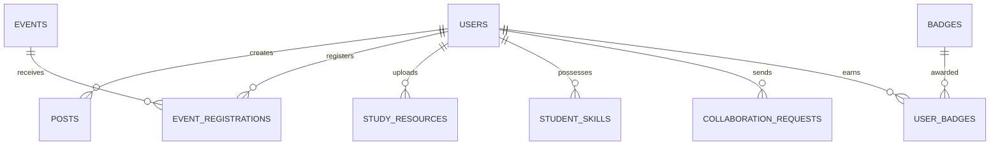
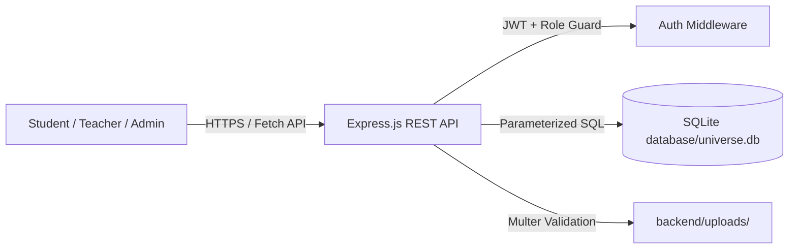

# UniVerse 3.0 — Project Presentation & Syllabus Mapping

## 1. Abstract
UniVerse is an integrated smart campus web platform that unifies student communication, event discovery, academic resource sharing, teammate matching, gamified engagement, lost-and-found recovery, anonymous feedback, and administrative moderation into a single responsive localhost application.

## 2. Problem Statement & Objectives
College campuses often rely on fragmented chat groups, notice boards, and spreadsheets. UniVerse solves this by providing:
- Role-based authentication (`student`, `teacher`, `admin`) with `bcryptjs` hashing and JWT sessions.
- Persistent SQLite storage with real CRUD operations and verified XP gamification.
- An immersive 3D Three.js + GSAP landing experience paired with an accessible, dark/light-themed workspace.

## 3. System Architecture & Diagrams

### Entity-Relationship (ER) Overview

### Use Case & Data Flow

## 4. Web Technologies Syllabus (12 Experiments Mapping)
1. **HTML5 Semantic Structure:** `<header>`, `<nav>`, `<main>`, `<section>`, `<article>`, `<aside>`, `<footer>` across all 13 pages.
2. **HTML5 Forms & Validation:** Registration, Login, Event Creation, StudyHub Upload, Lost & Found, Marketplace, and Anonymous Voice forms.
3. **HTML5 Canvas & SVG:** Interactive SVG Ecosystem Diagram (`index.html`), Interactive SVG Campus Map (`campus-quest.html`), HTML5 Canvas Analytics Charts (`dashboard.html`, `admin.html`), and Three.js WebGL Canvas (`index.html`).
4. **CSS3 Selectors, Box Model & Positioning:** `design-system.css` demonstrating element, class, ID, pseudo-classes (`:hover`, `:focus-visible`), sticky navigation, and glassmorphism.
5. **CSS Flexbox & Grid + Responsive Media Queries:** `.app-shell` Flexbox layout, Bootstrap 5 responsive grids, and mobile sidebar drawer.
6. **CSS Transitions & Keyframe Animations:** `@keyframes floatY`, `toastIn`, `skeletonPulse`, and `prefers-reduced-motion` accessibility rules.
7. **Bootstrap 5 Components:** Cards, modals, dropdowns, nav pills, tables, and form controls.
8. **JavaScript Fundamentals & DOM Manipulation:** Modular ES6+ (`api.js`, `app.js`, `interactions.js`, `smart-buddy.js`).
9. **Event Handling & Timers:** Live event countdowns (`setInterval`), mouse-tilt cards, and keyboard-accessible SVG map nodes.
10. **Asynchronous JS (`fetch`, `async/await`, Promises):** All REST API interactions and toast feedback.
11. **Node.js & Express.js REST APIs:** Modular `routes/`, `controllers/`, `middleware/`, and `fs` file handling.
12. **Database Integration & Security:** SQLite (`node:sqlite`), `bcryptjs` password hashing, JWT authentication, and role-based access control.
